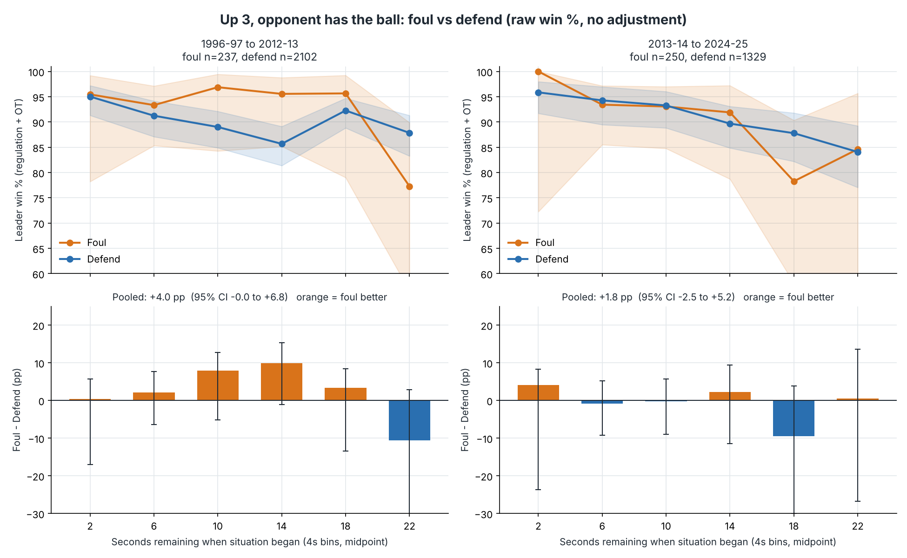

# foul-up-3

**Should the leading team foul when up 3 with under 24 seconds left?**
A data-driven myth-buster using 29 seasons of NBA play-by-play (1996-97 to 2024-25).

## Hypothesis tested (H_strong)

Leader is up exactly 3, strictly under 24 seconds remain, the opponent has the ball.
Claim: the leader should foul **every single time**.

## The simple test

Raw win % when the leader fouls vs defends, by seconds left, split into two eras
(data starts 1996-97). No modelling, just counts and 95% intervals.



| Era | Fouled / defended | Foul minus defend | 95% CI |
|---|---|---|---|
| 1996-97 to 2012-13 | 237 / 2,102 | +4.0 pp | -0.0 to +6.8 |
| 2013-14 to 2024-25 | 250 / 1,329 | +1.8 pp | -2.5 to +5.2 |

Both eras lean slightly towards fouling; neither interval excludes zero.

## Deeper analysis (optional)

Adjusting for time, timeouts, fouls, opponent and era gives +2.2 pp (95% CI -0.5 to +5.1): **NOT PROVEN**.
Details, break-even FT% model and subgroups: [`reports/results.md`](reports/results.md).

## Reproduce

```bash
pip install -e . pytest
git clone --depth 1 https://github.com/shufinskiy/nba_data data/external/nba_data   # GIT_LFS_SKIP_SMUDGE=1
make ingest states simple   # ~2 min for ingest; `make analyze` for the deeper report
make test
```

## Structure

- `src/foulup3/config.py` - paths, priors, the `Definition` of H_strong
- `ingest.py` - raw play-by-play to tidy parquet
- `states.py` - infers possession event by event, finds the decision state, classifies FOUL / NO_FOUL
- `features.py` - leak-free pre-game priors (shrunk FT%, 3P%, net rating from earlier games only)
- `analysis.py` - adjustment ladder, balance, subgroups
- `model.py` - break-even free-throw model
- `simple.py` - the simple two-era chart
- `plots.py`, `report.py` - figures and generated `results.md`
- `tests/` - synthetic-game unit tests plus a golden real-game check

## Limitations

- Observational: unmeasured confounding (who is fouled, coach intent) can remain.
- Only 487 fouling cases; the interval is wide (about 3.2x more data needed to confirm +2.2 pp).
- Fouled players shot 70% vs a 76% team prior, so team FT% is a rough proxy.
- Possession is inferred from events, not observed (1 conflict in 36,668 games).
