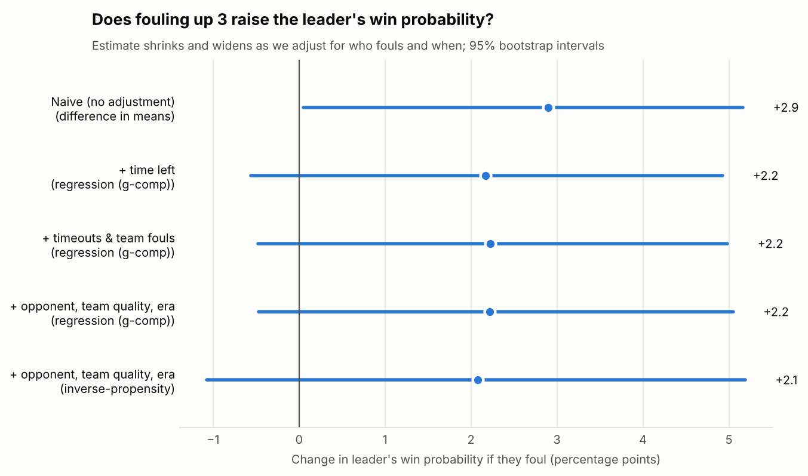
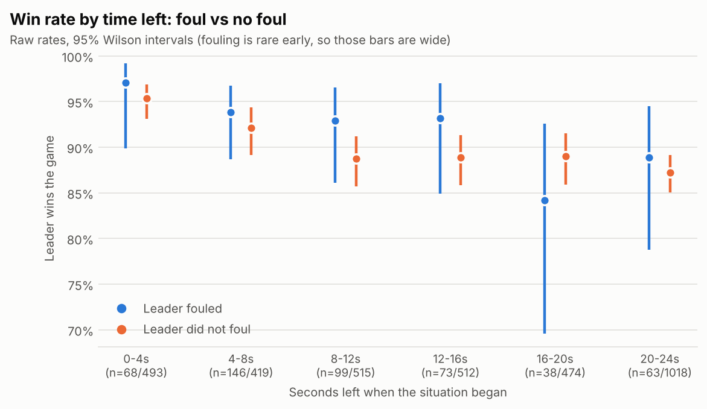
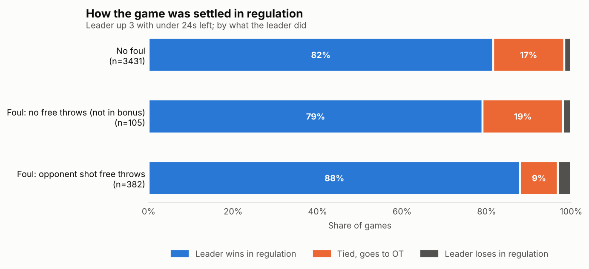
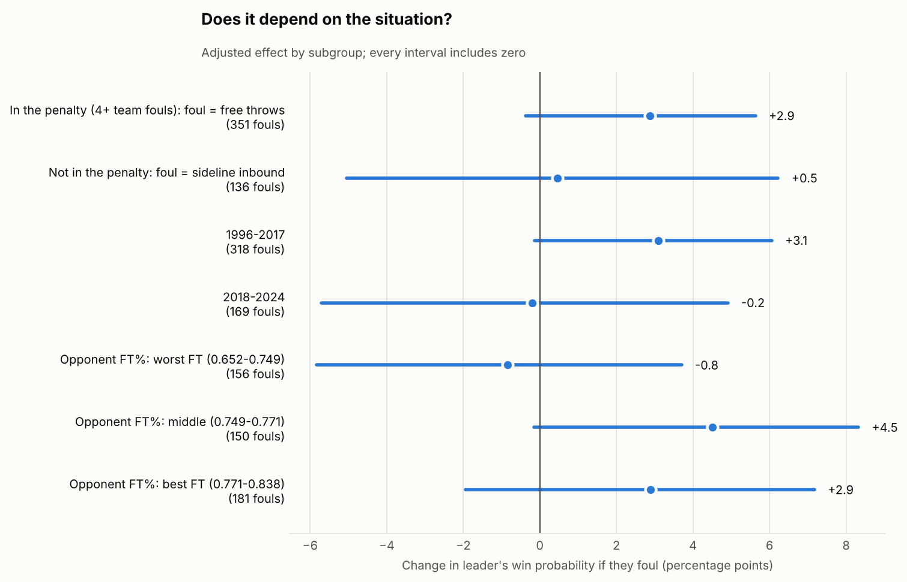
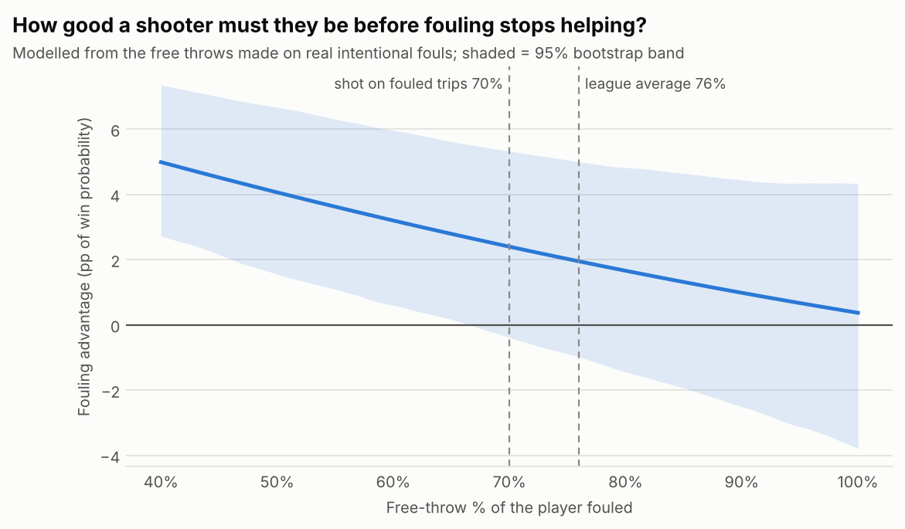

# Results: does fouling up 3 work?

> Generated by `python -m foulup3.cli analyze`. Numbers below are produced by the code, not typed.

## The hypothesis

**H_strong:** with the leader up exactly 3 and under 24 seconds left, the opponent having the ball, the leader should foul *every single time*. We test it as: does the leader's chance of winning go up when they foul at the first chance, compared with when they don't?

## Verdict: **NOT PROVEN**

After adjusting for time left, timeouts, team fouls, opponent shooting, team quality and era, the leader's win probability is **+2.2 percentage points** when fouling (95% CI -0.5 to +5.1). That is 2.2 extra wins per 100 such situations, and the point estimate favours fouling, but the interval includes zero, so the data cannot tell 'helps a little' from 'makes no difference'.

- Sample: **3,918** situations over 29 seasons (1996-97 to 2024-25), of which 487 had a foul and 3,431 did not. Possession-inference conflicts: 1 in 36,668 games.
- Power: the interval half-width is about 2.8 pp. To confirm an effect of this size (80% power) we would need roughly **3.2x** as much data (about 1,540 fouling cases against the 487 the league produced in 29 seasons).

## 1. The adjustment ladder

Teams that foul are stronger and tend to do it with less time left, which flatters fouling. Each row adjusts for more.

| model | estimator | effect (pp) | lo | hi |
|---|---|---|---|---|
| Naive (no adjustment) | difference in means | +2.9 | +0.1 | +5.2 |
| + time left | regression (g-comp) | +2.2 | -0.6 | +4.9 |
| + timeouts & team fouls | regression (g-comp) | +2.2 | -0.5 | +5.0 |
| + opponent, team quality, era | regression (g-comp) | +2.2 | -0.5 | +5.1 |
| + opponent, team quality, era | inverse-propensity | +2.1 | -1.1 | +5.2 |

Covariate balance (standardised mean difference, foul vs no foul; |SMD| < 0.1 is well balanced):

| covariate | smd_raw | smd_weighted |
|---|---|---|
| t_entry | -0.46 | -0.01 |
| to_used_leader | +0.16 | +0.06 |
| to_used_opp | +0.10 | -0.03 |
| q4_leader_fouls | -0.11 | -0.03 |
| opp_ft_pct_prior | +0.08 | -0.09 |
| opp_tp_pct_prior | +0.09 | +0.03 |
| leader_net_pg_prior | +0.11 | +0.01 |
| opp_net_pg_prior | +0.08 | +0.02 |
| home_leader | +0.05 | -0.03 |
| season_c | +0.26 | -0.07 |

## 2. Time left

| time left | n_foul | n_nofoul | win_foul | win_nofoul | diff (pp) | lo | hi |
|---|---|---|---|---|---|---|---|
| 0-4s | 68 | 493 | 97.1% | 95.3% | +1.7 | -5.6 | +4.8 |
| 4-8s | 146 | 419 | 93.8% | 92.1% | +1.7 | -3.9 | +5.9 |
| 8-12s | 99 | 515 | 92.9% | 88.7% | +4.2 | -3.0 | +8.9 |
| 12-16s | 73 | 512 | 93.2% | 88.9% | +4.3 | -4.3 | +9.2 |
| 16-20s | 38 | 474 | 84.2% | 89.0% | -4.8 | -19.7 | +4.1 |
| 20-24s | 63 | 1018 | 88.9% | 87.2% | +1.7 | -8.6 | +7.7 |

## 3. How games were settled

When the foul sends the opponent to the line, ties drop sharply; but a make-both sequence shrinks the lead to one and creates a small chance of losing in regulation, which not fouling rarely does. When the leader is not yet in the penalty, the foul only buys a sideline inbound and ties do not fall.

| group | n | win_reg_pct | tie_to_ot_pct | lose_reg_pct | win_overall |
|---|---|---|---|---|---|
| Foul: no free throws (not in bonus) | 105 | 79.0% | 19.0% | 1.9% | 90.5% |
| Foul: opponent shot free throws | 382 | 88.0% | 8.9% | 3.1% | 93.2% |
| No foul | 3431 | 81.5% | 16.8% | 1.6% | 89.7% |

## 4. Subgroups

With 136-351 fouls per subgroup these intervals are wide. Treat patterns as hints, not findings.

| situation | n_foul | n_nofoul | naive_rd | adj_rd | adj_lo | adj_hi |
|---|---|---|---|---|---|---|
| In the penalty (4+ team fouls): foul = free throws | 351 | 2676 | +3.6 | +2.9 | -0.4 | +5.6 |
| Not in the penalty: foul = sideline inbound | 136 | 755 | +1.0 | +0.5 | -5.1 | +6.2 |

| era | n_foul | n_nofoul | foul_rate | naive_rd | adj_rd | adj_lo | adj_hi |
|---|---|---|---|---|---|---|---|
| 1996-2017 | 318 | 2720 | 10.5% | +3.7 | +3.1 | -0.1 | +6.1 |
| 2018-2024 | 169 | 711 | 19.2% | +1.3 | -0.2 | -5.7 | +4.9 |

| opp_ft_tercile | ft_pct_range | n_foul | n_nofoul | naive_rd | adj_rd | adj_lo | adj_hi |
|---|---|---|---|---|---|---|---|
| worst FT | 0.652-0.749 | 156 | 1150 | +0.4 | -0.8 | -5.8 | +3.7 |
| middle | 0.749-0.771 | 150 | 1156 | +4.8 | +4.5 | -0.2 | +8.3 |
| best FT | 0.771-0.838 | 181 | 1125 | +3.6 | +2.9 | -1.9 | +7.2 |

## 5. Break-even free-throw percentage

After a foul, the leader's win rate was 100.0% / 94.0% / 91.1% when the opponent made 0 / 1 / 2 free throws. Making both is the worst case for the leader (the lead shrinks to 1). Rebuilding the win probability for any shooter skill gives the curve above.

| FTs made | n | win | tie | lose in reg |
|---|---|---|---|---|
| 0.0 | 39.0 | 100.0% | 5.1% | 0.0% |
| 1.0 | 149.0 | 94.0% | 9.4% | 0.0% |
| 2.0 | 190.0 | 91.1% | 9.5% | 6.3% |

- Break-even FT%: **none in 40-100%**. The advantage is about +4.1 pp against a 50% shooter and +1.9 pp at the league-average 76%.
- Players fouled on these trips shot **70.0%**, below the 76.1% their teams shoot. That suggests the player fouled is typically a weaker shooter than his team (or shoots worse under pressure), so team free-throw % is only a rough proxy for the number that matters.

## Limitations

- Observational data: adjustment handles what we measured. Unmeasured things (who has the ball, who gets fouled, coach quality, shot clock) may still bias the estimate.
- Intentional fouls are inferred from context (leader's non-shooting foul in the window), not labelled.
- 'No foul' includes later fouls (flag `fouled_later`, ~5%), so we compare 'foul at first chance' with 'did not foul at first chance'.
- Possession is inferred from events; it conflicted in 1 of 36,668 games.
- Timeouts are counted as events (coach-challenge timeouts excluded), not read from a rulebook-aware remaining count, because the rules changed over 29 seasons.
- Team priors use schedule order (game id) within a season, not calendar dates.
- The break-even curve rests on a few hundred two-shot trips, so its band is wide.
